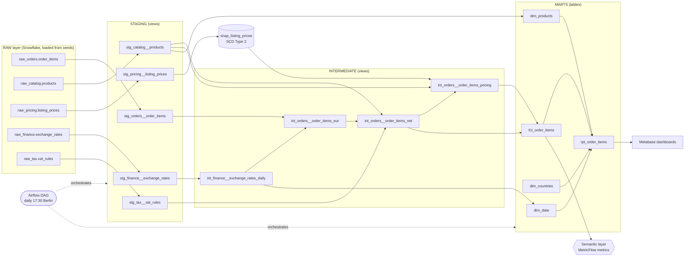
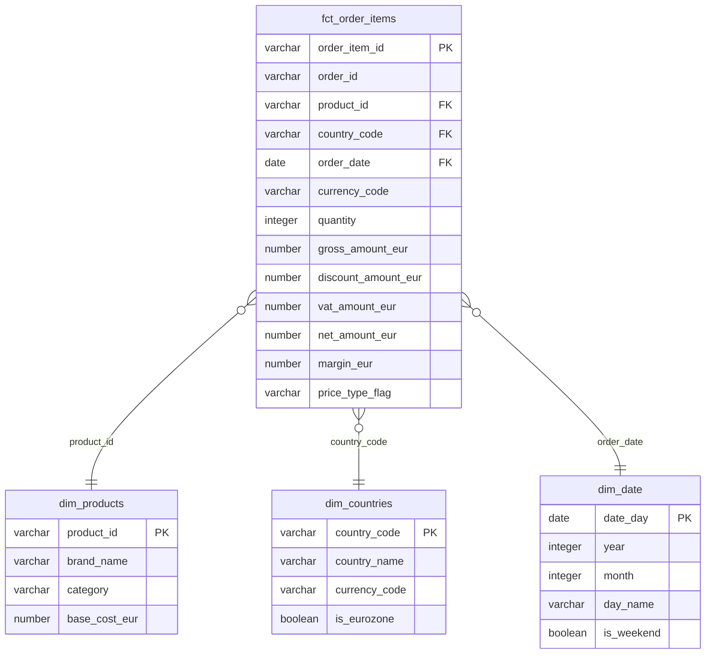

# Ecommerce Sales & Financial Performance: Revenue, Margins & Trends (EUR)

This project is an end-to-end data pipeline that turns raw e-commerce sales data from four European markets into consistent, reliable financial reporting. Sales are recorded in different currencies and include local taxes, so the raw figures cannot be compared directly. The pipeline converts every sale to euros using the exchange rate of the day it occurred, removes the applicable VAT to calculate net revenue, and preserves historical prices so that margins and discounts can be audited. The results are published as a tested star schema, with business metrics such as net revenue, margin and average order value defined once and shared across all reports, and presented in interactive dashboards. The solution is built with **dbt** on **Snowflake**, orchestrated with **Airflow** and visualised in **Metabase**.

> **Sample data:** This project uses a synthetic dataset of 500 order lines from four markets, covering 1 to 25 March 2024. The data was designed to reflect real-world conditions, so it deliberately includes weekend orders, missing exchange rates, missing tax rules, empty discounts and products that are absent from the catalog. It contains no real company data.

---

## Contents

- [Business Problem](#business-problem)
- [Business Requirements](#business-requirements)
- [Solution Overview](#solution-overview)
- [Tech Stack](#tech-stack)
- [Architecture](#architecture)
- [Data Sources](#data-sources)
- [Layer by Layer](#layer-by-layer)
- [Results](#results)
- [BI Dashboards](#bi-dashboards)
- [How to Run](#how-to-run)

---

## Business Problem

- **Domain:** Cross-border e-commerce and retail finance
- **Markets:** Germany (DE), United Kingdom (UK), Switzerland (CH), Poland (PL)

With sales spread across four European markets, local teams and headquarters each report revenue in their own way, leaving no common basis for comparison.

| Team | How they report sales |
|---|---|
| Local country managers | In the local currency (EUR, GBP, CHF, PLN), including local tax |
| Berlin headquarters | In euros, excluding VAT |

Three factors make the gap harder to close:

- **Prices and exchange rates change every day.** Promotions and currency movements mean the same sale is worth a different amount depending on the date.
- **Historical prices are lost.** The pricing system overwrites a price when it changes, so there is no record of what an item cost last week.
- **Tax rules vary and change over time.** VAT depends on the country, the product category and the date. For example, UK children's clothing has 0% VAT, while Germany charges 19% on all clothing.

As a result, finance and commercial reports differ by hundreds of thousands of euros each month, and there is no single figure the business can trust.

---

## Business Requirements

| # | Requirement | What it means |
|---|---|---|
| 1 | **Daily standardized financials (EUR base)** | Convert every sale to EUR using the exchange rate **of the transaction date**, not today's rate. |
| 2 | **True net revenue** | Separate gross revenue (what the customer paid) from net revenue (excluding the VAT that applied to that country, category and date). |
| 3 | **Historical price and margin auditing** | Answer "what was the list price and margin of product X in country Y on date Z, versus what the customer actually paid?" precisely. |
| 4 | **Markdown and discount transparency** | Label every line as sold at **full price**, an official **promotional price**, or with an ad-hoc **basket discount**. |

Every requirement is answered at **one row per order line item**, the grain of the data.

---

## Solution Overview

The pipeline moves data through a series of stages, each with one clear job. Raw data is cleaned first, then business rules are applied, and finally the results are published as reporting tables. Every stage is built with dbt in Snowflake and tested before the next one uses it.

| Layer | What It Does |
|---|---|
| **Staging** | Clean and rename the raw tables, one model per source. No business logic. |
| **Snapshot** | Capture the overwritten pricing table as **SCD Type 2** history, so past prices can be looked up. |
| **Intermediate** | Hold the business logic: a daily FX calendar, EUR conversion, VAT lookup and pricing and margin. |
| **Marts** | Publish a star schema (one fact, three dimensions) plus a flat reporting table for BI. |
| **Semantic layer** | Define metrics once (MetricFlow), so every tool computes net revenue the same way. |
| **Orchestration and BI** | Airflow runs the whole pipeline daily. Metabase reads the marts. |

The key design decisions:

| Problem | Solution |
|---|---|
| ECB publishes no rates on weekends and holidays | Build a **date spine** (one row per day per currency) and carry the last published rate forward. Flag those rows. |
| EUR orders have no row in the rate table | `LEFT JOIN` and treat EUR as rate `1.0`. German orders are never dropped. |
| A non-EUR order has no rate at all | Leave the rate `NULL` rather than silently using 1.0. A test catches it. |
| Pricing table overwrites in place | **dbt snapshot** (SCD Type 2) on `last_modified_at`. Orders join to the price version valid at order time. |
| Orders older than the first recorded price | Use the earliest known price and set `is_price_history_gap = true`. |
| No listing exists for a product and market | Keep the line, leave list prices `NULL`, label the price type **Unknown**. |
| Tax differs by country, category and date | Time-travel join: the VAT rule must be valid on the order date. |
| Category missing from the VAT rules | `LEFT JOIN`, apply 0% and set `is_vat_rate_missing = true`, so revenue is never lost and the gap is visible. |
| Missing product cost | `COALESCE` to 0 for the math and set `is_base_cost_missing`. The margin % metric uses only lines with a known cost. |
| Product sold but absent from the catalog | `dim_products` adds an **inferred "Unknown" member**, so the fact never has a broken key. |

---

## Tech Stack

| Area | Tool |
|---|---|
| Warehouse | **Snowflake** (`ECOMMERCE_DB`) |
| Transformation | **dbt Core 1.8.7** with `dbt-snowflake 1.8.4` |
| Test helpers | **dbt_utils** (expression, equality, sequential-values and multi-column unique tests) |
| Semantic layer | **dbt MetricFlow** (`dbt-metricflow 0.7.1`) |
| Orchestration | **Apache Airflow 2.10** in Docker (LocalExecutor, Postgres metadata DB) |
| BI | **Metabase** in Docker, plus **dbt-metabase** to sync dbt documentation into it |
| Language | SQL (Snowflake dialect) with Jinja, Python (Airflow DAG), PowerShell |
| Version control | Git and GitHub (feature branch and pull request workflow) |

---

## Architecture



**Snowflake schemas** (a custom `generate_schema_name` macro keeps names clean, with no environment prefix):

`RAW_ORDERS`, `RAW_CATALOG`, `RAW_PRICING`, `RAW_FINANCE`, `RAW_TAX` → `STAGING` → `SNAPSHOTS` → `INTERMEDIATE` → `MARTS`

### Star Schema



The diagram shows the key columns and main measures. The full column list for every table is in the dbt documentation (`dbt docs generate`).

---

## Data Sources

Five source tables feed the pipeline. They come from different systems, follow different update patterns, and each has a known data quality limitation that the models must handle.

| Source | Type | Grain | Key Limitation |
|---|---|---|---|
| `raw_orders.order_items` | Kafka stream (append-only) | One row per order line | Prices are **gross** (VAT included) and in **local currency** |
| `raw_catalog.products` | PostgreSQL CDC | One row per SKU | `base_cost_eur` can be NULL. Some ordered products are missing from the catalog |
| `raw_pricing.listing_prices` | Microservice replica (mutable) | Current price per product and country | **Overwrites in place**, no history |
| `raw_finance.exchange_rates` | Daily ECB pull | One rate per currency per weekday | **No weekends or holidays**, and no EUR row |
| `raw_tax.vat_rules` | Static ERP seed | Country × category × validity window | Rates change over time. Some categories have no rule |

A sixth small seed, `reference.ref_countries`, supplies country names and currencies for `dim_countries`.

For this project, `dbt seed` loads the source data into the `RAW_*` schemas in Snowflake. In production, this landing layer would be populated by Fivetran or Airbyte and Kafka CDC.

---

## Layer by Layer

Each layer has one job. The left column is the layer, then what we build there, then the tests that protect it.

| Layer | What we build | Tests |
|---|---|---|
| **Staging**<br>*(views)* | One model per source.<br>Trim and upper/lower-case keys and codes, cast types, add `_local` suffixes, derive a UTC order date.<br>Weekday-only FX grain is kept on purpose. | `unique` and `not_null` on keys<br>`accepted_values` on country and currency<br>Quantity and prices positive<br>Discount never negative or above the line amount<br>Orphan products flagged as **warn** |
| **Snapshot**<br>*(SCD Type 2)* | `snap_listing_prices` keeps every version of a listing price.<br>Key `listing_id`, timestamp `last_modified_at`.<br>History starts at the first run, so the daily schedule builds the audit trail. | One row per listing and version<br>`dbt_scd_id` unique<br>Product exists in the catalog<br>**Custom:** versions never overlap, only the latest is open-ended |
| **Intermediate**<br>*(views)* | Business logic in 4 models (see table below):<br>FX calendar → EUR amounts → VAT and net revenue → pricing and margin. | **Generic:** one rate per currency per day, no date gaps, rate > 0, EUR rate = 1, EUR round-trips to local, net + VAT = gross, flags consistent<br>**Custom:** VAT rules never overlap, price was active at order time<br>**Unit tests (12):** weekend fill, EUR rate, NULL discount, VAT boundary date, price version boundary, missing listing, flag precedence |
| **Marts**<br>*(tables)* | Star schema: `fct_order_items` plus `dim_products`, `dim_countries`, `dim_date`.<br>`rpt_order_items` is the flat table for BI. | Fact reconciles to the intermediate layer (row count and revenue)<br>Reporting table reconciles to the fact<br>Keys unique, `relationships` to every dimension<br>Amounts non-negative<br>No missing calendar days |
| **Semantic layer**<br>*(MetricFlow)* | 3 semantic models, a time spine and 10 metrics (net revenue, margin %, average order value and more), each defined once. | Metric results checked against Snowflake (see Results) |
| **Orchestration**<br>*(Airflow)* | DAG `ecommerce_dbt_daily`, every day at 17:30 Berlin, after the ECB publishes.<br>`deps → staging → snapshot → intermediate → marts → test`<br>2 retries and a failure callback. | `dbt test` is the last task, so a failing test fails the run |
| **BI**<br>*(Metabase)* | Two dashboards on `rpt_order_items`.<br>Read-only Snowflake role.<br>Descriptions synced from dbt with `dbt-metabase`. | Headline numbers reconciled across Metabase, MetricFlow and Snowflake |

### Intermediate models

| Model | Requirement | Grain | What it does |
|---|---|---|---|
| `int_finance__exchange_rates_daily` | 1 | Date × currency | Date spine that carries the last published rate over weekends and holidays, with a carried-forward flag |
| `int_orders__order_items_eur` | 1 | Order line | Joins the daily rate (EUR = 1.0) and computes gross and discount in EUR |
| `int_orders__order_items_net` | 2 | Order line | Adds category and the VAT rate valid on the order date, then `net = (gross − discount) / (1 + VAT)` |
| `int_orders__order_items_pricing` | 3 and 4 | Order line | Joins the price version valid at order time, then computes list price in EUR, discount depth, margin and `price_type_flag` |

### Marts

| Model | Type | Grain | Primary key |
|---|---|---|---|
| `fct_order_items` | Fact | Order line | `order_item_id` |
| `dim_products` | Dimension | Product, plus inferred "Unknown" members | `product_id` |
| `dim_countries` | Dimension | Country | `country_code` |
| `dim_date` | Dimension | Calendar day | `date_day` |
| `rpt_order_items` | Reporting | Order line, flat | `order_item_id` |

### Semantic layer metrics

| Metric | Definition |
|---|---|
| `net_revenue` | Sum of net EUR, ex-VAT and after discounts |
| `average_order_value` | Net revenue ÷ distinct orders |
| `margin_pct` | Margin ÷ net revenue, known-cost lines only |
| `gross_revenue`, `total_discounts`, `vat_collected`, `margin`, `units_sold`, `total_orders`, `discount_rate` | Sums, counts and ratios |

---

## Results

The pipeline produces one reconciled set of financial measures, calculated the same way for every market.

- **Single, consistent revenue calculation.** Each order line carries gross and net revenue in EUR. The gross amount is converted at the ECB rate for the order date, using the last published rate for weekends and holidays. The net amount removes the VAT rate that was valid in that country and category on that date.
- **Reconciled across every layer.** Net revenue, average order value and margin percentage return identical results in Metabase, in the MetricFlow semantic layer and in a direct Snowflake query. Reconciliation tests also confirm that no rows or revenue are lost between the intermediate models, the fact table and the reporting table.

| Figure | Metabase | MetricFlow | Snowflake |
|---|---|---|---|
| Net revenue | 122,998.94 | 122,998.94 | 122,998.94 |
| Average order value | 476.74 | 476.74 | 476.74 |
| Margin % (known cost) | 37% | 0.37 | 0.37 |

- **Price history is auditable.** Any order can be matched to the exact list price in force when it was placed, versus what the customer paid.
- **Nothing is silently dropped.** All 500 order lines survive to the dashboard. Where a fallback was needed (no VAT rule, no cost, no listing, carried-forward FX, unknown product), the line is kept and flagged, and the Data Quality dashboard counts them.
- **Tested at every layer:** generic tests, custom SQL tests, unit tests on mock data, and reconciliation tests between layers.

---

## BI Dashboards

Two Metabase dashboards present the results: one for sales and financial performance, and one for data quality. All amounts are in EUR, excluding VAT and after discounts.

### Dashboard 1: Sales & Financial Performance


**How to read it**

| Element | What it shows |
|---|---|
| **Filters** (top) | Date, country and product category selectors. Changing one updates every chart on the page. |
| **Margin %** | Profit as a share of net revenue. Only lines with a known product cost are counted, so missing costs do not distort it. |
| **Net revenue** | Total sales in EUR after discounts, with VAT removed. |
| **Average order value** | Net revenue divided by the number of distinct orders. |
| **Net revenue by day** | Daily net revenue across the period. It shows when sales peak or drop. |
| **Net revenue by country** | Each market's contribution to total net revenue, for comparing markets in a common currency. |
| **Net revenue by category** | How much each product category contributes to net revenue. |
| **Order lines by price type** | The share of order lines sold at full price, at a promotional price, with a basket discount, or with an unknown list price. |
| **Definitions** | The calculation behind each metric, shown on the dashboard. |

**Drill-down:** setting the Country filter to Germany shows the market on its own.


**Insights from this data**

- **Overall:** €122,998.94 net revenue at a 37% margin across 500 order lines, with an average order value of €476.74.
- **Markets:** Germany is the largest at €47,614.16 (about 39% of the total), followed by the UK. Switzerland and Poland are each around €20k.
- **Categories:** Electronics account for about 78% of net revenue (€95.56k), so revenue is concentrated in one category.
- **Pricing:** 49.6% of order lines carry a basket discount and 27.4% sell at full price, which suggests where a pricing review could start.
- **Trend:** revenue is uneven from day to day, so single days should be read against the overall trend.

> The data is synthetic, so these figures show how to read the dashboard, not real business performance.

### Dashboard 2: Data Quality


This dashboard counts how many order lines rely on a fallback, so the team can see how much of the revenue figure rests on an assumption. Because nothing is dropped, each count is the number of lines that were **kept but flagged**.

| Flag | What it means | Business impact |
|---|---|---|
| `lines_missing_vat_rate` | No VAT rule found, so 0% was applied | Net revenue may be overstated |
| `lines_missing_base_cost` | Product cost is missing | Excluded from margin %, so the figure covers known-cost lines only |
| `lines_price_history_gap` | Order is older than the first recorded price | Earliest known price used, so list price is approximate |
| `lines_without_listing` | No price listing for this product and market | List price is blank and the price type is Unknown |
| `lines_on_carried_forward_fx` | Weekend or holiday order | Last published ECB rate used |
| `lines_unknown_product` | Product is not in the catalog | Category and brand are Unknown |
| `total_lines` | Total number of order lines | Baseline for judging each flag as a share of all lines |

**How to use it:** if a flag count grows over time, upstream data is degrading, for example finance has not added a VAT rule for a new category. Fix the source and the flags clear on the next run.

---

## How to Run

**Prerequisites:** Python, a Snowflake account, Docker (for Airflow and Metabase).

```powershell
# 1. Environment (pinned versions)
python -m venv .venv
.\.venv\Scripts\Activate.ps1
pip install -r requirements.txt

# 2. In Snowflake, as SYSADMIN, create the database and the raw schemas once:
#    CREATE DATABASE ECOMMERCE_DB;
#    CREATE SCHEMA ECOMMERCE_DB.RAW_ORDERS;  (and RAW_CATALOG, RAW_PRICING, RAW_FINANCE, RAW_TAX)
#    Then add a Snowflake connection named "ecommerce_project" to your dbt profiles.yml.

# 3. Build
dbt deps
dbt seed          # load the synthetic raw data
dbt build         # run models, snapshot and tests in dependency order
dbt docs generate && dbt docs serve
```

- **Airflow:** see `airflow/` (`.env.example`, `docker-compose.yml`). The UI runs on port 8080.
- **Metabase:** see [bi/README.md](bi/README.md). The UI runs on port 3000.

### Project Structure

```
airflow/              Airflow DAG and Docker setup
bi/                   Metabase setup, Snowflake read-only access script, dbt-metabase sync
docs/dashboards/      Dashboard screenshots
macros/               generate_schema_name override
models/
  staging/            stg_* views and source definitions
  intermediate/       int_* views, tests and unit tests
  marts/              fct_, dim_, rpt_ tables
  marts/semantic/     MetricFlow semantic models, metrics, time spine
seeds/                Synthetic raw data
snapshots/            snap_listing_prices (SCD Type 2)
tests/                Custom singular tests
```
